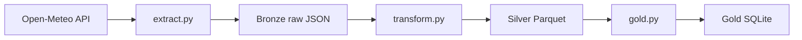

# Azure Medallion Pipeline

A Python data pipeline that downloads hourly weather history, cleans it into
typed Parquet files, and builds daily city summaries, using the bronze, silver
and gold layers. Built step by step, with Azure deployment as the next stage.

## Architecture




| Layer | What it holds | Written by |
|---|---|---|
| Bronze | Raw API response, unchanged | `src/extract.py` |
| Silver | Hourly data with real date-times, one file per city | `src/transform.py` |
| Gold | One row per city per day (average, min, max), upserted | `src/gold.py` |

## Project structure

```
src/
  config.py          cities, dates, folder paths, logging setup
  extract.py         API to bronze JSON, with retries
  transform.py       bronze to silver Parquet, with validation
  gold.py            silver to daily table in SQLite (upsert)
  run_pipeline.py    runs the three stages in order
tests/               pytest tests for gold and validation
examples/            earlier practice pipeline
```

## Data source

Hourly historical weather from the [Open-Meteo](https://open-meteo.com) archive API.

| Item | Value |
|---|---|
| Endpoint | `https://archive-api.open-meteo.com/v1/archive` |
| Authentication | None (no API key) |
| Variable used | `temperature_2m` (hourly, in °C) |
| Cities | Pune, Mumbai (coordinates in `src/config.py`) |
| Date range | 2025-01-01 to 2025-12-31 (set in `src/config.py`) |
| Volume | 8,760 hourly rows per city |

Example request:

```
https://archive-api.open-meteo.com/v1/archive?latitude=18.52&longitude=73.86&start_date=2025-01-01&end_date=2025-01-03&hourly=temperature_2m
```

The response is JSON. Each variable is a column-style list, so `hourly.time` and
`hourly.temperature_2m` line up by position. Open-Meteo snaps the requested
coordinates to the nearest point on its data grid, so the latitude and longitude
in the response differ slightly from the request.

## Sample result

| city | year_avg | coldest | hottest |
|---|---|---|---|
| mumbai | 27.3 | 18.1 | 39.0 |
| pune | 25.1 | 13.0 | 40.8 |

Daily summaries for 2025 (hourly temperature, 17,520 rows in, 730 rows out).

## Current status

- [x] Bronze: download raw hourly weather for several cities
- [x] Silver: typed columns, one Parquet file per city
- [x] Gold: daily min, average and max per city, in SQLite
- [x] Idempotent load (upsert, safe to re-run)
- [x] Unit tests with pytest
- [x] Shared settings in one config file
- [x] Data quality checks and run logging
- [ ] Azure: ADLS Gen2 storage for bronze and silver
- [ ] Azure: Data Factory to schedule the pipeline
- [ ] Azure: Key Vault for secrets

A smaller first exercise (users API into SQLite) is in `examples/`.

## How to run

Run these from the project root (the folder containing `src/`).

```
pip install requests pandas pyarrow pytest
python src/run_pipeline.py
pytest
```

The run writes `data/bronze`, `data/silver`, `data/gold.db` and `pipeline.log`.
None of these are committed to Git.

## Design decisions

- **Bronze keeps the raw API response unchanged**, so silver and gold can be
  rebuilt at any time without calling the API again.
- **Silver uses Parquet**, not CSV, because it keeps column types (dates stay
  dates) and is the standard format for Azure data lakes.
- **Gold is loaded with an upsert** on (city, date), so re-running the pipeline
  never creates duplicates. A pytest test covers this.
- **Data quality checks run before silver is written.** Missing values,
  duplicate timestamps and impossible temperatures stop the run with a clear error.
- **Extract retries timeouts and connection errors** up to 3 times with a
  growing wait. Other errors, such as a 404, fail straight away because a
  retry wouldn't help.
- **Settings live in one file** (`src/config.py`) so cities, dates and paths
  are never repeated across scripts.

## Known limitations

- Runs locally; storage is local folders and SQLite.
- Fixed date range, no scheduling yet.
- Only temperature is downloaded.
- Azure deployment is the next step.

