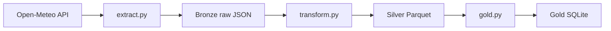

# Azure Medallion Pipeline

A learning project: building a data pipeline in Python, step by step,
and growing it into an Azure-style medallion architecture
(bronze, silver, gold).

## Architecture



| Layer | What it holds | Written by |
|---|---|---|
| Bronze | Raw API response, unchanged | `src/extract.py` |
| Silver | Hourly data with real date-times, one file per city | `src/transform.py` |
| Gold | One row per city per day (average, min, max), upserted | `src/gold.py` |

## Current status

- [x] Bronze: download raw hourly weather for several cities
- [x] Silver: typed columns, one Parquet file per city
- [x] Gold: daily min, average and max per city, in SQLite
- [x] Idempotent load (upsert, safe to re-run)
- [x] Unit tests with pytest
- [x] Shared settings in one config file
- [ ] Azure: ADLS Gen2 storage for bronze and silver
- [ ] Azure: Data Factory to schedule the pipeline
- [ ] Azure: Key Vault for secrets
- [x] Data quality checks and run logging

A smaller first exercise (users API into SQLite) is in `examples/`.

## How to run

```
pip install requests pandas pyarrow pytest
python src/extract.py
python src/transform.py
python src/gold.py
pytest
```