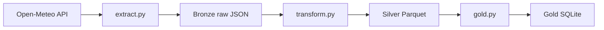

# Azure Medallion Pipeline

A learning project: building a data pipeline in Python, step by step,
and growing it into an Azure-style medallion architecture
(bronze, silver, gold).

## Architecture



| Layer | What it holds | Written by |
|---|---|---|
| Bronze | Raw API response, unchanged | `src/extract.py` |
| Silver | Hourly data with real date-times, one file per city | `src/transform.py` |
| Gold | One row per city per day (average, min, max), upserted | `src/gold.py` |

## Current status

- [x] Bronze: download raw hourly weather for several cities
- [x] Silver: typed columns, one Parquet file per city
- [x] Gold: daily min, average and max per city, in SQLite
- [x] Idempotent load (upsert, safe to re-run)
- [x] Unit tests with pytest
- [x] Shared settings in one config file
- [ ] Azure: ADLS Gen2 storage for bronze and silver
- [ ] Azure: Data Factory to schedule the pipeline
- [ ] Azure: Key Vault for secrets
- [x] Data quality checks and run logging

A smaller first exercise (users API into SQLite) is in `examples/`.

## How to run

```
pip install requests pandas pyarrow pytest
python src/run_pipeline.py
pytest
```

## Design decisions

- **Bronze keeps the raw API response unchanged**, so silver and gold can be
  rebuilt at any time without calling the API again.
- **Silver uses Parquet**, not CSV, because it keeps column types (dates stay
  dates) and is the standard format for Azure data lakes.
- **Gold is loaded with an upsert** on (city, date), so re-running the pipeline
  never creates duplicates. A pytest test covers this.
- **Data quality checks run before silver is written.** Missing values,
  duplicate timestamps and impossible temperatures stop the run with a clear error.
- **Extract retries timeouts and connection errors** up to 3 times with a
  growing wait. Other errors, such as a 404, fail straight away because a
  retry wouldn't help.
- **Settings live in one file** (`src/config.py`) so cities, dates and paths
  are never repeated across scripts.

## Known limitations

- Runs locally; storage is local folders and SQLite.
- Fixed date range, no scheduling yet.
- Only temperature is downloaded.
- Azure deployment is the next step.