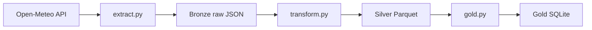

# Azure Medallion Pipeline

A learning project: building a data pipeline in Python, step by step,
and growing it into an Azure-style medallion architecture
(bronze, silver, gold).

## Architecture



| Layer | What it holds | Written by |
|---|---|---|
| Bronze | Raw API response, unchanged | `src/extract.py` |
| Silver | Hourly data with real date-times, one file per city | `src/transform.py` |
| Gold | One row per city per day (average, min, max), upserted | `src/gold.py` |

## Current status

- [x] Extract from a public API with error handling
- [x] Transform nested JSON into a clean table
- [x] Load into SQLite
- [x] Logging
- [x] Real dataset with thousands of rows
- [x] Raw files saved as bronze layer
- [x] Clean silver layer (typed columns, Parquet files)
- [x] Gold layer: daily city summaries in SQLite
- [x] Incremental loads (no duplicates)
- [x] Tests with pytest
- [ ] Azure: ADLS Gen2, Databricks, Data Factory

## How to run

```
pip install requests pandas pyarrow pytest
python src/extract.py
python src/transform.py
python src/gold.py
pytest
```